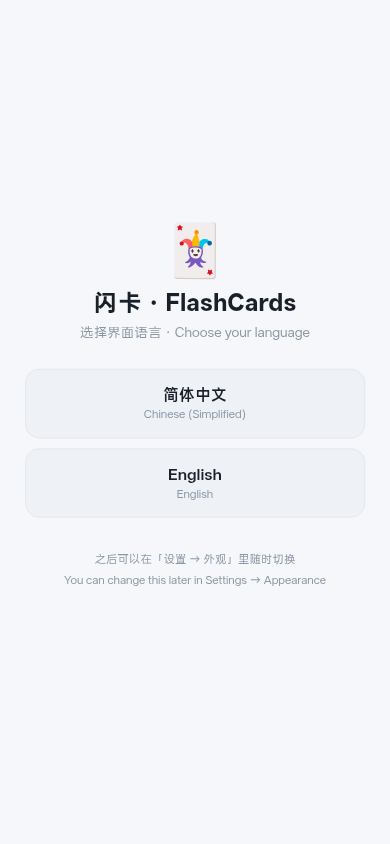
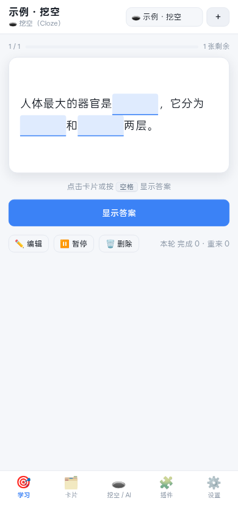
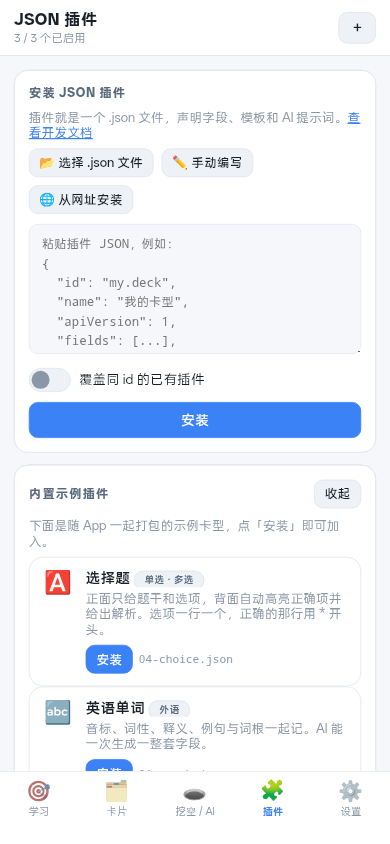
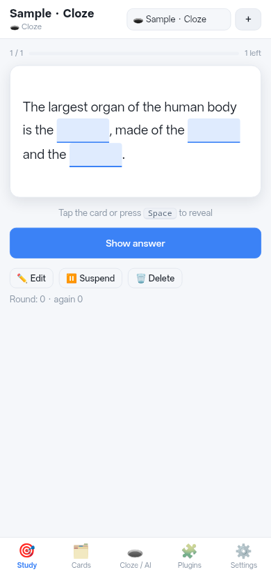

<div align="center">

# 🃏 闪卡 · FlashCards

**纯前端 · 零依赖 · 离线可用** 的间隔重复（SRS）闪卡工具

没有构建步骤，没有 `npm install`，没有后端 —— 双击 `index.html` 就能用，
也能原封不动塞进 WebView 封装成 APK。

[](#快速开始)
[](#文件结构)
[](#自检)
[](#自检)
[](#-界面语言)

<p>
  
  
  
  
</p>

**文档** &nbsp;·&nbsp; [插件开发文档](插件开发文档.md) &nbsp;·&nbsp; [打包成 APK](android/README-打包.md) &nbsp;·&nbsp; [自检说明](#自检)

</div>

---

## 目录

- [它解决什么问题](#它解决什么问题)
- [快速开始](#快速开始)
- [功能](#功能)
  - [挖空](#挖空)
  - [AI](#ai)
  - [JSON 插件系统](#json-插件系统)
  - [学习与数据](#学习与数据)
  - [界面语言](#界面语言)
  - [外观与自定义 CSS](#外观与自定义-css)
- [配置 AI](#配置-ai)
- [封装成 APK](#封装成-apk)
- [自检](#自检)
- [文件结构](#文件结构)
- [已知边界](#已知边界)
- [许可](#许可)

---

## 它解决什么问题

大部分闪卡工具的问题不在「能不能记」，而在**把材料变成卡这一步太累**：
一段法条、一个定义、一页书，手打挖空打半小时，记的时候只有五分钟。

所以这个工具的重心放在**输入的自动化**和**卡型的可扩展**上：

| | |
|---|---|
| **AI 挖空** | 把原文丢给大模型，它只挖「要点」——法条挖要件、定义挖术语、公式挖变量，其余原文逐字保留 |
| **本地智能挖空** | 没网 / 没配 Key 时的兜底：`Intl.Segmenter` 分词 + 逆文档频率打分，挑信息量最高的词 |
| **JSON 插件** | 卡型是一个纯 JSON 文件。声明字段、模板、AI 提示词就能新增一种卡片类型，**不用改代码、不用重新打包** |
| **自定义 CSS** | 设置里贴一段样式表，改配色 / 字号 / 间距 / 卡片样式，立刻生效 |

数据全在自己设备上（`localStorage`），不联网也能用。

---

## 快速开始

### 1. 直接打开（最快）

```bash
git clone https://github.com/archerhonst/flashcard.git
cd flashcard
python3 -m http.server 8000     # 然后浏览器打开 http://localhost:8000
```

或者**直接双击 `index.html`** 也行。用 `file://` 打开能跑是刻意的设计：
代码用的是传统 `<script>` 标签而不是 ES Module，专门避开 `file://` 下的 CORS 限制
（这一点对后面封装 APK 同样重要）。

> 💾 **数据存在浏览器的 `localStorage` 里**（命名空间前缀 `flashcards.v1.`）。
> 意味着：清浏览器数据 / 换浏览器 / 换设备，数据都不会跟过去。
> **请定期用「设置 → 导出备份」。**

### 2. 手机浏览器「添加到主屏幕」

在手机浏览器里打开上面的地址，选「添加到主屏幕」，得到一个接近原生 App 的体验。
如果你只是自己用，**这条路比封装 APK 省事得多**。

### 3. 封装成 APK

见 [封装成 APK](#封装成-apk)。仓库里 `android/` 已经是一个可直接用 Android Studio 打开的完整工程。

---

## 功能

### 挖空

**人工挖空**，三种操作方式随材料形态切换：

- 选中文字 → 点「挖空选中」
- **点词挖空**模式：直接戳分词后的词，一次一个空
- 手写 `{{c1::答案::提示}}` 标记

**AI 挖空**：把材料丢给大模型，自动只挖要点。

**本地智能挖空**（不联网的兜底）：`Intl.Segmenter` 分词 + 逆文档频率打分，挑信息量最高的词。

出题时：

- 一张卡多个空 → 可选「每空一张卡」或「全部挤在一张卡」，按空逐个提问
- 正面遮空（带提示），背面显示答案并**高亮当前提问的那个空**
- 提示文字用 `{{c1::答案::提示}}` 写在第二个 `::` 后面

### AI

- 走 **OpenAI 兼容的 `/chat/completions`**，任何兼容服务都能接：
  OpenAI / DeepSeek / Moonshot / 智谱 / 通义 / SiliconFlow / Ollama / LM Studio …
- 按**插件声明的字段**生成卡片：模型返回的 JSON 直接映射到字段
- 接口不可用 / 没配 Key → **自动回退本地算法**，功能不中断
- 设置页有「连接测试」按钮，一键验证地址 / Key / 模型
- 提示词是插件的一部分，所以「怎么生成」这件事也能跟着卡型一起被分享

### JSON 插件系统

插件 = **一个纯 JSON 对象**，声明字段 Schema、正反面模板、AI 提示词、专属 CSS。

- 三种安装方式：粘贴 JSON / 选择文件 / 从 URL 下载
- 安装前逐条校验，错误定位到具体字段
- 插件 CSS 自动**作用域隔离**，互不污染
- 插件**不能执行任意代码**（纯数据驱动），所以从网上下别人的插件是安全的
- 可导出分享成 `<id>.plugin.json`
- **内置示例可以一键安装**：插件页自动读 `plugins/index.json` 列出来
  （封装成 APK 后系统文件选择器看不到 assets 里的文件，这条路径是装示例的唯一办法）
- **插件可自带多语言**：json 里加一个可选的 `i18n` 块

自带 5 个示例插件，完整 API 见 **[插件开发文档.md](插件开发文档.md)**：

| 文件 | 内容 | 演示了什么 |
|---|---|---|
| [99-starter-template.json](plugins/99-starter-template.json) | 最小骨架 | 复制它就能开始写 |
| [04-choice.json](plugins/04-choice.json) | 选择题（单选/多选） | `mcq` 过滤器、行首 `*` 标正确项 |
| [01-vocab.json](plugins/01-vocab.json) | 英语单词 | `select` / `list` 字段、过滤器 |
| [02-law-cloze.json](plugins/02-law-cloze.json) | 法条挖空 | `mode:"cloze"`、AI 挖空提示词 |
| [03-code.json](plugins/03-code.json) | 代码 / API 记忆 | `checkbox`、反向区块 `{{^}}` |

### 学习与数据

- **SM-2 间隔重复**：重来 / 困难 / 良好 / 简单 四档，自动算下次复习时间
- **撤销上次评分**（`Ctrl+Z` 或 `z`）：点错档位不用重学一遍，调度状态整体还原
- **打字作答**（可选开关）：挖空卡在空里直接打字，回车判分。
  全角半角、大小写、首尾标点、中文词间空格都不影响判分；
  一个空可写多个可接受答案（`{{c1::细胞|细胞质}}`）；
  答错会在你写的字旁边补上正确答案，而不是只打个红叉
- **难卡检测**：连续答错达到阈值（默认 4 次）标成「难卡」并提示拆分 ——
  一张卡被反复答错通常是这张卡太胖或太含糊，不是学习者的问题
- **一键拆卡**：难卡可以交给 AI 拆成多张小卡，或把原卡挂起换成新卡
- 每日新卡与复习上限、进度条、键盘快捷键（空格翻面，`1`–`4` 评分，`e` 编辑）
- 牌组 + 标签 + 全文搜索
- **自动快照**：每次启动在 `IndexedDB` 里留一份数据快照（保留最近若干份），
  「恢复到这份」可整体回滚。恢复前还会先自动备份当前状态，回滚错了还能再救回来
- **CSV / TSV 导入导出**：和 Excel、Anki 表格互通。分隔符自动识别（逗号 / Tab），
  表头按字段 key 或字段标签匹配，对不上的列直接忽略；含逗号、换行、双引号的单元格都能正确解析
- 完整备份 / 恢复（导出 JSON）、单牌组导出

### 界面语言

- **进入软件前先选语言**（简体中文 / English），之后可在 `设置 → 外观` 随时切换
- 首次启动没有记录才弹选择页；选过之后不再打扰
- **整界面、内置卡型、内置示例插件一起换**；插件自带 `i18n` 块时也会跟着换
- 词典是「中文原文 → 译文」的直接映射（[`js/lang/en.js`](js/lang/en.js)），
  `tools/staticcheck.js` 会强制**每一句含中文的界面文案都有英文译文**，漏一句就红灯

新增一门语言只要两步：照 `js/lang/en.js` 加一个文件，再到 [`js/i18n.js`](js/i18n.js)
的 `LANGS` 里登记一行。语言选择页会自动多出按钮，自检也会自动把它纳入核对范围。

### 外观与自定义 CSS

- 深色 / 浅色 / 跟随系统三种主题，字号可调
- **自定义 CSS**：设置 → 外观里直接写样式表，作用到整个 App

写进去的就是一段普通样式表，原样注入 `<head>`（在 `app.css` 之后，所以同特异性下**你写的会赢**）。

能改的常用变量（都在 `app.css` 的 `:root` 里定义）：

| 变量 | 作用 |
|---|---|
| `--bg` `--bg-2` `--bg-3` | 背景三层（主背景 / 卡片 / 更亮的块） |
| `--line` | 分隔线、边框 |
| `--fg` `--fg-2` `--fg-3` | 文字三级（主要 / 次要 / 最弱） |
| `--primary` `--primary-2` | 主色（按钮、选中态） |
| `--green` `--amber` `--red` | 评分与提示色 |
| `--radius` `--radius-sm` | 圆角 |
| `--card-w` | 卡片最大宽度 |
| `--fs` | 基准字号 |

```css
/* 换主色 */
html[data-theme] { --primary: #e11d48; }

/* 卡片圆角更大、正文行距更松 */
html[data-theme] { --radius: 20px; }
.flip-front, .flip-back { line-height: 2; }
```

> ⚠ **一定要用 `html[data-theme]` 而不是 `:root`。**
> 浅色主题的变量定义在 `html[data-theme="light"]` 上，特异性比 `:root` 高。
> 只写 `:root{--primary:…}` 时浅色模式下**不生效**（深色模式看起来是好的，很容易误判）。
> `html[data-theme]` 特异性与它相同、位置又在后面，两种主题都能覆盖。

几个注意点：

- 只改**某一张卡**的样式，别写在这里 —— 写在插件的 `css` 字段里（会自动加插件前缀隔离）
- 想恢复原样：点「清空」再「应用样式」
- 这里不解析也不过滤你的 CSS（和插件 CSS 一样的信任模型），写坏了顶多界面难看：
  点「清空」→「应用样式」就能救回来，**数据不受影响**

---

## 配置 AI

「设置」页填入：

| 项 | 说明 |
|---|---|
| API 地址 | 兼容 `/v1/chat/completions` 的地址。填到 `/v1` 或直接填完整的 `/chat/completions` 都行，程序会自动补全 |
| API Key | 本地服务（`localhost` / `127.0.0.1`）可以留空 |
| 模型 | 如 `gpt-4o-mini`、`deepseek-chat`、`qwen-plus` |
| JSON 输出模式 | 默认开。部分服务不支持 `response_format`，勾掉即可（会降低 JSON 稳定性） |
| 超时 | 默认 90 秒，长材料可以调大 |

常见服务填写示例：

| 服务 | API 地址 | 模型 |
|---|---|---|
| OpenAI | `https://api.openai.com/v1` | `gpt-4o-mini` |
| DeepSeek | `https://api.deepseek.com/v1` | `deepseek-chat` |
| Moonshot | `https://api.moonshot.cn/v1` | `moonshot-v1-8k` |
| 智谱 | `https://open.bigmodel.cn/api/paas/v4` | `glm-4-flash` |
| SiliconFlow | `https://api.siliconflow.cn/v1` | `Qwen/Qwen2.5-7B-Instruct` |
| Ollama（本地） | `http://localhost:11434/v1` | `llama3.1` |

> ⚠️ **API Key 存在 `localStorage` 里，是明文的。**
> 这是一个纯前端离线工具，没有后端可以替你保管密钥。在共用设备上使用请留意，
> 或者改用本地模型（Ollama / LM Studio）。
>
> 设置页的 Key 输入框**不做掩码**（是 `type="text"` 而不是 `password`）。理由很直接：
> 字符遮起来并不增加安全性 —— 值本来就是明文存的 —— 却会让「自己核对一遍 Key 有没有粘错」
> 变得很麻烦；在 WebView 里 `password` 框还容易触发系统密码管理器自动填充，弹窗挡住视线。
> 同时加了 `autocomplete="off" autocapitalize="off" autocorrect="off" spellcheck="false"`，
> 避免移动端输入法把 Key 改成首字母大写、或自动纠正 / 加下划线。

---

## 封装成 APK

`android/` 是一个**可直接用 Android Studio 打开**的完整工程：Kotlin + WebView + 本地 assets。
详细步骤见 **[android/README-打包.md](android/README-打包.md)**。极简版：

1. 用 Android Studio 打开 `android/`（或命令行 `./gradlew assembleDebug`）
2. `app/build.gradle.kts` 里已配好一个 Gradle 任务，会**自动把上层目录的 web 文件同步进 `assets/`** ——
   你只改网页代码，构建时自动带进包里，不用手动复制
3. 构建 → 得到 APK

> 🔧 **发布前记得改 `applicationId`。** 现在是占位的 `com.example.flashcards`
> （见 [`android/app/build.gradle.kts`](android/app/build.gradle.kts)），上架或分发前应改成你自己的包名。
> `versionName` 当前是 `1.0.0`，`minSdk = 24` / `targetSdk = 34` / `compileSdk = 34`。

工程已经处理好的坑：

- **`file://` 加载**：assets 用 `WebViewAssetLoader` 映射到虚拟 https 域名
  （`https://appassets.androidplatform.net/assets/www/index.html`），
  这样 `localStorage` 有稳定的 origin（用 `file://` 的话某些机型上 `localStorage` 不可用 / 不持久）
- **导出文件**：WebView 不支持 `blob:` + `<a download>`，所以走一段 JS 桥
  （`FlashCardsNative.saveFile`）写进系统「下载」目录。Android 10+ 用 MediaStore（免权限），
  9 及以下写公共目录（先申请 `WRITE_EXTERNAL_STORAGE`）；桥不可用时网页自动回落到标准 blob 下载
- 返回键先回退网页历史，再退出
- 文件选择（导入插件 / 恢复备份）通过 `onShowFileChooser` 打通系统文件选择器
- 切后台 / 退出前主动调用 `WebView.onPause()`，逼 Chromium 把 `localStorage` 提交落盘，
  避免直接杀进程丢掉最后的编辑
- 屏幕旋转不重建 Activity（`configChanges`），避免正在编辑的卡片丢失
- 非本站地址一律不在 App 内加载（防止第三方页面顶掉闪卡壳）
- 只申请两个权限：`INTERNET`（AI 调用）和 `WRITE_EXTERNAL_STORAGE`
  （已用 `maxSdkVersion="28"` 限定只在 Android 9 及以下生效）

---

## 自检

三套脚本**零依赖**，只要本机有 Node（≥ 18）：

```bash
node tools/selftest.js           # 行为测试：调度算法、挖空映射、模板引擎、插件校验、导入导出…
node tools/staticcheck.js        # 静态检查：全局名、跨模块调用拼写、DOM id、资源、文案全覆盖
node tools/check-apk-shell.js    # 可选：检查另一个 Java 壳工程（本仓库不含，找不到就跳过）
```

全绿的样子：

```
✓ 全部通过：360 项检查
✓ 静态检查全部通过：172 项
```

它们的存在理由是：这个项目**没有构建步骤**，也没有测试框架，
而所有模块都通过 `window` 上的全局对象互相引用 ——
这种写法最容易出的错就是「把 `DB.listCards` 写成 `DB.listCard`」或者
「模板引用了不存在的 DOM id」，浏览器里只会在运行时悄悄不工作。
`staticcheck.js` 专门抓这一类问题。

`staticcheck.js` 里有一组「**文案全覆盖**」：把所有 `T('…')` 的字面量抽出来，
凡是含中文的都必须能在 `js/lang/en.js` 里找到对应译文，词典里也不允许多出用不到的孤儿条目。
加新界面文案时忘了补英文，这里会直接报出漏掉的那句和它所在的**文件行号**。

`selftest.js` 里最后一段是「AI 传输层」：用假 `fetch` 和假 `FlashCardsNative` 逼出两条路，
确认**有原生桥时走桥、没桥时回落 `fetch`**，两边都别坏。

接 CI 的话加这三行就行，不需要 `npm install`。

---

## 文件结构

```
flashcard/
├── index.html              # 唯一入口，按顺序加载下面的脚本
├── app.css                 # 全部样式（CSS 变量做主题切换）
├── js/
│   ├── i18n.js             # 界面语言：语言清单、词典注册、T() 取词、切换与持久化
│   ├── lang/
│   │   └── en.js           # 英文词典（键 = 中文原文，值 = 译文）
│   ├── util.js             # 工具：DOM、转义、模板引擎（Mustache 子集 + 过滤器）、localStorage 封装
│   ├── store.js            # 数据层：牌组/卡片/日志/SM-2 调度/导入导出
│   ├── cloze.js            # 挖空引擎：解析、明文↔标记双向映射、点词挖空、本地智能挖空、渲染、拆卡
│   ├── plugins.js          # JSON 插件系统：校验、安装、模板渲染、CSS 作用域、AI 提示词契约
│   ├── ai.js               # OpenAI 兼容客户端 + AI 挖空 / AI 生成卡片 + 本地兜底
│   └── app.js              # 视图层与全部交互
├── plugins/                # 示例插件（都是可以直接导入的 .json）
├── docs/                   # README 用的截图
├── tools/                  # 自检脚本
│   ├── selftest.js         # 把核心逻辑加载进 Node，跑 360 项行为测试
│   ├── staticcheck.js      # 不执行代码，静态扫 172 项接缝 / DOM id / 资源 / 文案全覆盖
│   └── check-apk-shell.js  # 可选：另一个 Java 壳工程的同步检查
├── 插件开发文档.md          # ★ 插件 API 完整参考
└── android/                # APK 封装工程（Kotlin）
    └── README-打包.md       # ★ 打包步骤、签名、排错
```

代码组织刻意保持「一个大文件一件事」的粒度，全部用 IIFE 挂到 `window`，
方便直接改、直接调试，不需要理解任何构建工具。

---

## 已知边界

- **数据只在 `localStorage`**：没有云同步，换设备靠导出 / 导入 JSON。
- AI 返回的 JSON 不做严格校验，模型胡说就会存进胡说 —— 批量生成后建议抽查。
- 挖空提示文字不能包含 `::`。
- 插件模板是 Mustache 子集：不支持自定义函数、`{{> partial}}`、循环变量别名。
- 插件里的 `study` 字段目前**不生效**（预留扩展位，详见插件文档第 6 节）。
- 从 URL 安装插件受浏览器 **CORS** 限制，对方服务器不允许跨域就会失败（错误信息里会提示）。
  同理，**在浏览器里**直接打开时，调第三方 AI 接口也可能被 CORS 拦（本地 Ollama 一般没事）。
  封成 APK 后这两条都会绕过：AI 请求改由原生代发（见 [android/README-打包.md](android/README-打包.md)）。
- 自动快照依赖 `IndexedDB`。极老的内核上快照区会显示「不支持」并提示改用导出备份，
  数据本身仍然正常读写。
- 打字作答的判分是**字符串级**的：全角半角、大小写、首尾标点、中文词间空格都能容忍，
  但不会做同义词判断 —— 同一张卡要接受多种说法，请用 `{{c1::答案1|答案2}}` 显式列出。

---

## 许可

随意使用和修改。内置的示例插件内容仅作格式演示，请勿作为学习资料的权威来源。
